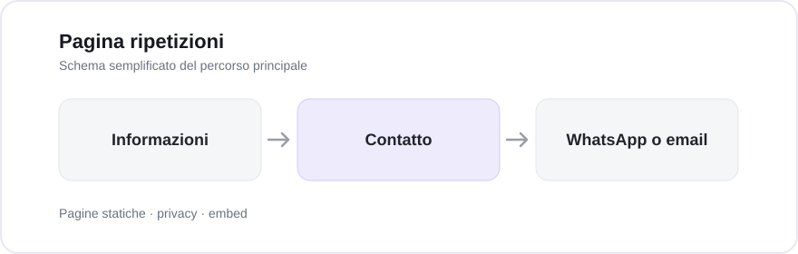

# Pagina ripetizioni

Pagina dedicata alle ripetizioni a Schio, Vicenza e online. Raccoglie informazioni utili e permette di preparare una richiesta di contatto senza un modulo con backend.

**Apri il progetto:** https://riccardobuzzolan.github.io/SitoRiccardoBuzzolan/

## Anteprima grafica

*Questa è l'immagine di condivisione del sito, non uno screenshot della pagina.*

## Come funziona

Il pannello di contatto è utilizzabile da tastiera; i contenuti esterni soggetti al consenso vengono caricati in base alle preferenze del visitatore.

## Tecnologie e struttura

Per verificare il progetto: `node --test tests/*.test.mjs` e `node scripts/check-site.mjs`.

Le informazioni su distribuzione, accessibilità, gestione dati e ripristino sono conservate nella [documentazione tecnica](docs/TECHNICAL.md).
